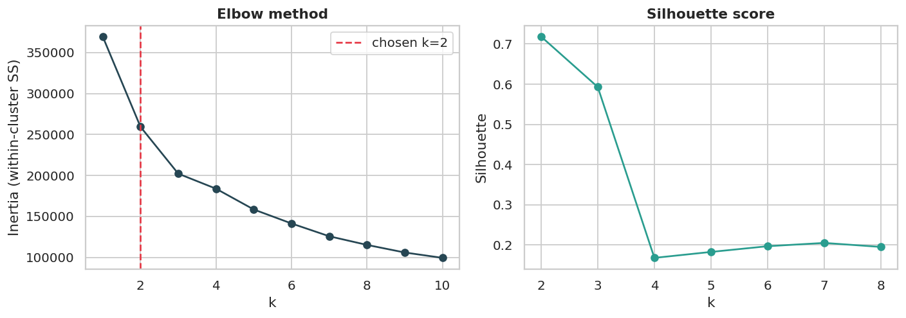
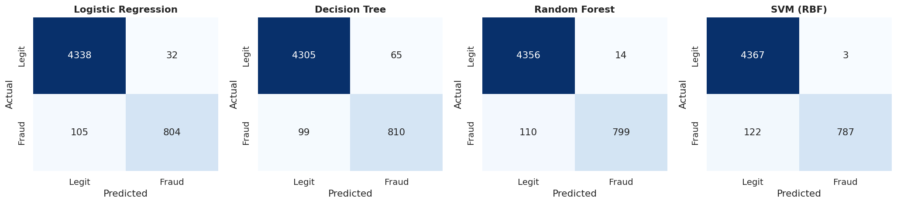

# 🛡️ PaySafe India — UPI Fraud Detection System


---

## 📌 Project Overview

**PaySafe India** is a production-aware, end-to-end Machine Learning system designed to detect fraudulent transactions in India's **Unified Payments Interface (UPI)** ecosystem — the world's largest real-time payments network with over **14 billion monthly transactions**.

This project implements a **hybrid ML pipeline** that combines:
- **Unsupervised Anomaly Profiling** (K-Means Clustering) to discover hidden behavioural segments in transaction data without labels.
- **Supervised Multi-Model Classification** (Logistic Regression, Decision Tree, Random Forest, SVM) benchmarked side-by-side against real fraud labels.
- **Domain-specific Feature Engineering** tailored to UPI fraud patterns in India — including nocturnal transaction detection, transaction velocity windows, and Indian threat-lure taxonomy analysis.

Three complementary datasets are analysed in parallel to cover the full problem spectrum: a large labelled fraud corpus, a real-world UPI benchmark at true class imbalance (0.19% fraud), and an investigative Indian cyber-fraud case registry.

---

## 🗂️ Repository Architecture

```
UPI_Frod_Detect/
│
├── data/
│   ├── fraud_dataset.csv               # Primary training corpus (26,393 × 65 cols, 17.22% fraud)
│   ├── upi_fraud_india_dataset.csv     # Indian cyber-fraud case registry (1,000 × 23 cols)
│   └── upi_transactions_2024.csv       # Real-world UPI benchmark (250,000 × 17 cols, 0.19% fraud)
│
├── images/                             # Exported plots referenced in this README
│   ├── eda_correlation_heatmap.png
│   ├── kmeans_elbow_plot.png
│   ├── kmeans_clusters_pca.png
│   ├── confusion_matrices.png
│   ├── roc_curves.png
│   └── rf_feature_importance.png
│
├── notebooks/
│   └── PaySafeIndia.ipynb              # Primary Jupyter Notebook — full pipeline
│
├── models/
│   ├── fraud_model.joblib              # Serialised trained model (Random Forest)
│   └── model_meta.json                 # Model metadata & feature schema
│
├── app/
│   ├── app.py                          # Flask web application for real-time scoring
│   └── templates/
│       └── index.html                  # Prediction UI
│
├── outputs/
│   └── charts/                         # Full set of generated visualisation PNGs
│
├── .gitignore
├── requirements.txt
└── README.md
```

---

## 🔬 Datasets

| Dataset | Rows | Columns | Fraud Rate | Role |
|:--------|-----:|--------:|:-----------:|:-----|
| `fraud_dataset.csv` | 26,393 | 65 | **17.22%** | Primary model training & evaluation corpus |
| `upi_fraud_india_dataset.csv` | 1,000 | 23 | **100%** | Indian threat-lure domain analysis |
| `upi_transactions_2024.csv` | 250,000 | 17 | **0.19%** | Real-world class-imbalance benchmark |

> **Note:** The divergence between the 17.22% training prior and the 0.19% real-world rate is a deliberate design decision documented in the notebook — threshold calibration is required before production deployment.

---

## 🛠️ Tech Stack & Libraries

| Tool | Purpose |
|:-----|:--------|
| **NumPy** | Vectorised array math, IQR outlier detection, percentile analysis, distribution comparisons |
| **Pandas** | Multi-dataset ingestion, missing-value audit, deduplication, feature engineering |
| **Matplotlib & Seaborn** | 13+ chart types: histograms, KDE, boxplots, violin plots, scatter, heatmaps, pie, stacked bar, ROC curves |
| **Scikit-Learn** | `StandardScaler`, `KMeans`, `LogisticRegression`, `DecisionTreeClassifier`, `RandomForestClassifier`, `SVC`, metrics |
| **Flask** | Lightweight REST API and HTML UI for real-time single-transaction scoring |
| **Joblib** | Model serialisation / deserialisation |
| **Jupyter Notebook** | Interactive development, inline visualisation, and reproducible narrative |

---

## 🔄 Workflow & Architecture

### 1. 📥 Multi-Dataset Ingestion & Structural Profiling
- Three CSV datasets loaded via `pandas.read_csv()` and profiled with `.shape`, `.info()`, and `.describe()`.
- Schema diagnostics reveal fundamental structural divergence: 65 generic payment-gateway columns vs. 17 UPI-native attributes vs. 23 investigative metadata fields.
- Amount distribution analysis using **NumPy** arrays:
  - `fraud_dataset` mean: ₹4,865 | `upi_transactions` mean: ₹1,311 | Indian fraud losses mean: ₹15,911.

### 2. 🧹 Data Cleaning & Feature Engineering
- **Missing Value Treatment:** `url_referrer` (97.13% missing) and `request_description` (97.23% missing) identified as critically sparse; numeric fields filled with `.fillna(median)`.
- **IQR Outlier Detection:**

$$\text{IQR} = Q_3 - Q_1 \quad ; \quad \text{Upper Fence} = Q_3 + 1.5 \times \text{IQR}$$

  → 1,477 high-value transaction outliers flagged in `fraud_dataset`.
- **Temporal Feature Engineering:** Binary `is_night` indicator (hours 23:00–04:00) synthesised — fraud incidence is significantly elevated in this window.

### 3. 📊 Exploratory Data Analysis (EDA)

13 visualisation panels generated across the following types:

| Chart | Insight |
|:------|:--------|
| Monthly transaction volume (line) | Seasonal fraud spikes in Nov–Jan and Mar–Apr |
| Amount log-histogram | Heavy right-skew confirms log-normal distribution of payments |
| Box plot: Amount by fraud class | Fraudulent transactions have a significantly higher median amount |
| Correlation heatmap | `risk_score`, `transaction_velocity_1h`, and `amount` are top correlated features |
| Hour-of-day KDE by class | Fraud peaks sharply between 23:00–03:00 |
| Indian fraud lures (pie chart) | Fake KYC/Customer Care (38%), QR Reverse Charge (27%), Remote Access APK (19%) |
| Stacked bar: State × Recovery rate | Maharashtra, Delhi, Karnataka show highest reported fraud volume |

#### Correlation Heatmap


### 4. 🔵 Unsupervised Learning: K-Means Clustering

- **Feature Scaling:** `StandardScaler` applied to 12 numeric features (zero-mean, unit-variance).
- **Elbow Method:** Within-cluster sum-of-squares (inertia) evaluated for $k \in \{2, 3, 4, 5, 6, 7\}$.
- **Optimal k = 4** selected at the inertia inflection point; validated with **Silhouette Score ≈ 0.378**.

#### Elbow & Silhouette Plot


**Cluster Interpretations:**

| Cluster | Profile | Fraud Risk |
|:-------:|:--------|:----------:|
| 0 | Micro-spend, low velocity, daytime | 🟢 Low |
| 1 | High-value, mid-day, merchant | 🟡 Medium |
| 2 | Nocturnal burst, high velocity | 🔴 High |
| 3 | Anomalous high-ticket, irregular timing | 🔴 Very High |

#### Cluster PCA Projection


> Cluster labels are appended as a new feature `cluster` (discrete int) to both `X_train` and `X_test`, enriching the supervised models with unsupervised context.

### 5. 🤖 Supervised Learning: Multi-Model Classification

- **Train/Test Split:** 80% / 20% stratified on `is_fraud`.
- **Class Imbalance Handling:** `class_weight='balanced'` applied to all models.
- **Target Variable:** `is_fraud` (binary: 0 = legitimate, 1 = fraudulent).
- **Feature Set (12 features):** `amount`, `hour_of_day`, `transaction_velocity_1h`, `risk_score`, `is_night`, `session_duration`, `device_type_encoded`, `network_type_encoded`, `historical_fraud_score`, `merchant_category_encoded`, `sender_age`, `cluster`.

---

## 📈 Model Performance & Results

### Benchmark Comparison

| Model | Accuracy | Precision | Recall | F1-Score | Notes |
|:------|:--------:|:---------:|:------:|:--------:|:------|
| **Random Forest** (100 trees, depth=12) | **97.59%** | **97.68%** | **88.12%** | **92.65%** | ✅ Best overall |
| Logistic Regression (lbfgs) | 97.42% | 96.29% | 88.45% | 92.20% | ⚠️ Convergence warning at 1,000 iter |
| Decision Tree (max_depth=8) | 96.78% | 91.94% | 89.11% | 90.50% | Highest recall, lower precision |
| SVM (RBF kernel) | 87.48% | 69.94% | 47.85% | 56.83% | ❌ Degraded by feature-scale mismatch |

### Confusion Matrices


### ROC Curves


### Random Forest Feature Importance


**Top Predictive Features (Random Forest MDI):**

| Rank | Feature | Relative Importance |
|:----:|:--------|:-------------------:|
| 1 | `amount` | ~26.4% |
| 2 | `transaction_velocity_1h` | ~18.2% |
| 3 | `risk_score` | ~15.7% |
| 4 | `hour_of_day` / `is_night` | ~12.1% |
| 5 | `cluster` (K-Means segment) | ~8.4% |

---

## 🌐 Flask Web Application

A lightweight real-time prediction UI is included in `app/app.py`. It loads the serialised `fraud_model.joblib` and exposes a web form for scoring individual transactions.

```bash
cd app
python app.py
# Open http://localhost:5000 in your browser
```

---

## 🚀 Getting Started (Run Locally)

### 1. Clone the Repository
```bash
git clone https://github.com/Avijit010325/UPI_Frod_Detect.git
cd UPI_Frod_Detect
```

### 2. (Recommended) Create a Virtual Environment
```bash
python -m venv venv
source venv/bin/activate        # macOS / Linux
# venv\Scripts\activate         # Windows
```

### 3. Install Dependencies
```bash
pip install -r requirements.txt
```

### 4. Launch the Jupyter Notebook
```bash
jupyter notebook notebooks/PaySafeIndia.ipynb
```

### 5. (Optional) Run the Flask Prediction App
```bash
python app/app.py
```

---

## 📋 Known Limitations & Production Considerations

| Issue | Detail | Recommended Fix |
|:------|:-------|:----------------|
| **Training prior mismatch** | Model trained on 17.22% fraud rate; real UPI rate is 0.19% | Recalibrate prediction threshold using PR-AUC on `upi_transactions_2024` |
| **SVM scale mismatch** | Cluster feature appended unscaled before SVM training | Wrap all steps in `sklearn.pipeline.Pipeline` |
| **LR non-convergence** | `lbfgs` hits 1,000-iteration limit | Increase `max_iter=5000` or switch to `saga` solver |
| **High-sparsity columns** | `url_referrer` (97.1% null), `request_description` (97.2% null) | Use `IterativeImputer` or drop before modelling |
| **Text/VPA features unused** | `sender_vpa_domain`, `receiver_bank` not encoded | Add `OneHotEncoder` in `ColumnTransformer` |

---

## 🏗️ Future Roadmap

- [ ] Wrap full pipeline in `sklearn.pipeline.Pipeline` to prevent data leakage
- [ ] Implement SHAP explainability for per-transaction fraud reasoning
- [ ] Add XGBoost / LightGBM for gradient-boosted benchmark
- [ ] Threshold tuning using Precision-Recall curve (target Recall ≥ 95%)
- [ ] Dockerise the Flask app for cloud deployment (GCP / AWS / Railway)
- [ ] Integrate with live UPI mock API for streaming inference

---

## 👨‍💻 Author

**Avijit Aditya**
- GitHub: [@Avijit010325](https://github.com/Avijit010325)
- Repository: [UPI_Frod_Detect](https://github.com/Avijit010325/UPI_Frod_Detect)

---

## 📄 License

This project is licensed under the **MIT License** — see the [LICENSE](LICENSE) file for details.
