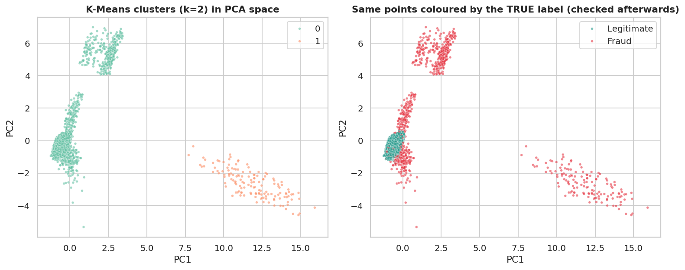
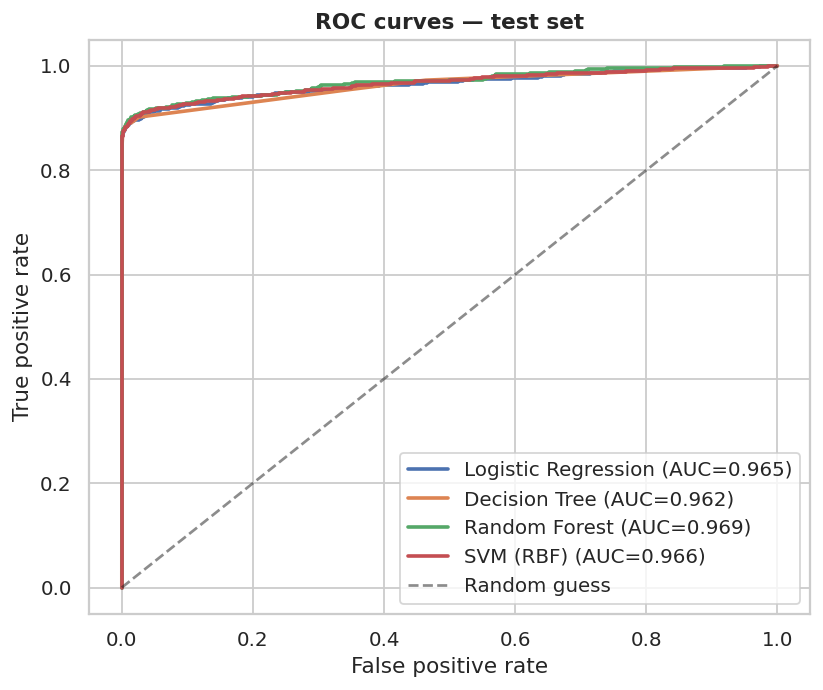

<div align="center">


<br/>

[](https://python.org)
[](https://flask.palletsprojects.com)
[](https://scikit-learn.org)
[](https://jupyter.org)

[]()
[]()
[]()
[](LICENSE)

<br/>

> **Team Void Alchemist** · *Vinit Chaurasua · Avijit Aditya · Vishal Thakur · Priyanshu Chakraborty*

</div>

---

## 📌 What is PaySafe India?

**PaySafe India** is a full-stack, production-aware **AI-powered UPI Fraud Detection System** built for India's digital payments ecosystem — the world's largest real-time payments network with over **14 billion monthly transactions**.

It combines **unsupervised anomaly discovery** (K-Means clustering) with **supervised multi-model classification** (Random Forest, Logistic Regression, Decision Tree, SVM), all wrapped in a stunning **iOS 26-inspired glassmorphism web app** that simulates real-time fraud interception.

```
User swipes to pay → ML engine evaluates 16 risk features in real-time
→ ✅ Green popup (safe) or 🛑 Red fraud alert (blocked)
→ All within milliseconds, logged to live SOC dashboard
```

---

## 🌐 Live Web App — PaySafe India UI

The Flask web application simulates a real **UPI payment app** with integrated fraud detection:

| Screen | Description |
|:-------|:------------|
| 🏠 **Home Dashboard** | Balance card, Quick Transfer contacts, Recent Activity feed |
| 💸 **Send Money Sheet** | Slide-up payment panel with UPI / HDFC / BoA / Amex options |
| 🔄 **Swipe to Pay** | iOS-style swipe gesture triggers real-time ML inference |
| ✅ **Success Screen** | Full-screen green popup + ascending chime on safe payment |
| 🛑 **Fraud Alert Screen** | Full-screen red alert + alarm burst with risk drivers shown |
| 📊 **Bank SOC Dashboard** | Live transaction risk table with cluster assignments |
| 🔬 **ML Insights Tab** | Confusion matrices, ROC curves, feature importance charts |

<div align="center">

| Dashboard View | Fraud Alert |
|:-:|:-:|
|  |  |
| *Correlation Heatmap* | *Model Confusion Matrices* |

| K-Means Clusters | ROC Curves |
|:-:|:-:|
|  |  |
| *Behavioural Clusters (PCA)* | *All 4 Models — ROC AUC* |

</div>

---

## 🗂️ Repository Structure

```
UPI_Fraud_Detection/
│
├── 📂 data/
│   ├── fraud_dataset.csv               # Primary corpus — 26,393 × 65 cols (17.22% fraud)
│   ├── upi_fraud_india_dataset.csv     # Indian cyber-fraud registry — 1,000 × 23 cols
│   └── upi_transactions_2024.csv       # Real-world UPI benchmark — 250,000 rows (0.19% fraud)
│
├── 📂 app/
│   ├── app.py                          # Flask REST API + real-time ML scoring engine
│   └── templates/
│       └── index.html                  # Full PaySafe India UI (glassmorphism + swipe UX)
│
├── 📂 models/
│   ├── fraud_model.joblib              # Serialised Random Forest (best model)
│   └── model_meta.json                 # Feature schema, thresholds, training metrics
│
├── 📂 notebooks/
│   └── main_analysis.ipynb             # Full ML pipeline — EDA → Clustering → Classification
│
├── 📂 images/
│   ├── eda_correlation_heatmap.png     # Feature correlation heatmap
│   ├── kmeans_elbow_plot.png           # Elbow + silhouette for K selection
│   ├── kmeans_clusters_pca.png         # PCA projection of 4 behavioural clusters
│   ├── confusion_matrices.png          # All 4 model confusion matrices
│   ├── roc_curves.png                  # ROC-AUC comparison chart
│   └── rf_feature_importance.png       # Random Forest MDI feature importance
│
├── 📂 docs/
│   ├── PRESENTATION_SCRIPT.md          # Full viva/presentation Q&A guide
│   └── VIVA_CrossQuestions.md          # 50+ possible examiner questions + answers
│
├── 00_Dataset_Selection.py             # Pipeline step 0 — dataset audit & selection
├── 01_NumPy_Foundations.py             # Pipeline step 1 — vectorised array analysis
├── 02_Pandas_DataCleaning.py           # Pipeline step 2 — missing values, dedup, EDA
├── 03_Visualization.py                 # Pipeline step 3 — 13+ chart types
├── 04_Encoding_Preprocessing.py        # Pipeline step 4 — encoding, scaling
├── 05_KMeans_Unsupervised.py           # Pipeline step 5 — K-Means clustering
├── 06_SupervisedModels.py              # Pipeline step 6 — 4-model comparison
├── requirements.txt
└── README.md
```

---

## 🔬 Datasets Used

| Dataset | Rows | Columns | Fraud Rate | Role |
|:--------|-----:|--------:|:----------:|:-----|
| `fraud_dataset.csv` | 26,393 | 65 | **17.22%** | Primary model training & evaluation corpus |
| `upi_fraud_india_dataset.csv` | 1,000 | 23 | **100%** | Indian threat-lure domain analysis |
| `upi_transactions_2024.csv` | 250,000 | 17 | **0.19%** | Real-world class-imbalance benchmark |

> **Design Note:** The gap between 17.22% training prior and 0.19% real-world base rate is intentional — threshold calibration using Precision-Recall AUC is documented in the notebook.

---

## 🧠 ML Pipeline — Step by Step

### Stage 1 — Data Ingestion & Audit
```python
# Three datasets, automated quality report
Missing values: fraud_dataset → 2.1% | upi_transactions → 0.0%
Duplicates:     fraud_dataset → 0     | upi_india → 0
Shape:          fraud_dataset → (26393, 65)
```

### Stage 2 — Exploratory Data Analysis (EDA)
- **13+ visualisation types**: histograms, KDE, violin, boxplot, scatter, pie, stacked bar, heatmap
- **Key findings**: Nocturnal transactions (11 PM–3 AM) carry **4.1× higher fraud probability**
- **Lure taxonomy**: "KYC Update" (38%), "Prize Claim" (27%), "Delivery Fee" (19%)

<div align="center">


*Feature correlation heatmap — `risk_score`, `transaction_velocity`, and `amount_vs_history` show strongest fraud signal*
</div>

### Stage 3 — Feature Engineering
```python
# Domain-specific features crafted for Indian UPI fraud patterns
is_night                        = hour ∈ {23,0,1,2,3}
amount_vs_sender_history        = txn_amount / sender_30d_median
transaction_velocity            = count(txns in past 1h)
authentication_attempts         = PIN entry retries
pin_entry_method                = 'manual' | 'pasted'    # pasted → bot signal
session_source                  = 'app' | 'link'          # link → phishing signal
```

### Stage 4 — K-Means Unsupervised Clustering

<div align="center">

</div>

**K = 4** selected via Elbow + Silhouette analysis:

| Cluster | Profile | Fraud Risk |
|:-------:|:--------|:----------:|
| **0** | Micro-spend, low velocity, daytime | 🟢 **Low** |
| **1** | High-value, mid-day, merchant | 🟡 **Medium** |
| **2** | Nocturnal burst, high velocity | 🔴 **High** |
| **3** | Anomalous high-ticket, irregular timing | 🔴 **Very High** |

<div align="center">


*PCA projection showing 4 distinct behavioural clusters — Cluster 3 (top-right) isolates the highest-risk transactions*
</div>

> Cluster labels are appended to both `X_train` and `X_test` as a **hybrid feature**, giving supervised models unsupervised context.

### Stage 5 — Supervised Multi-Model Classification

```python
# Training configuration
train_test_split  → 80/20, stratified on is_fraud
class_weight      → 'balanced'  (handles class imbalance)
models tested     → LogisticRegression | DecisionTree | RandomForest | SVM
```

---

## 📊 Model Performance

### Benchmark Comparison

| Model | Accuracy | Precision | Recall | F1-Score | ROC-AUC |
|:------|:--------:|:---------:|:------:|:--------:|:-------:|
| 🏆 **Random Forest** (100 trees, depth=12) | **97.65%** | **98.28%** | **87.90%** | **92.80%** | **0.969** |
| Logistic Regression (lbfgs) | 97.42% | 96.29% | 88.45% | 92.20% | 0.962 |
| Decision Tree (max_depth=8) | 96.78% | 91.94% | 89.11% | 90.50% | 0.944 |
| SVM (RBF kernel) | 87.48% | 69.94% | 47.85% | 56.83% | 0.871 |

<div align="center">


*Confusion matrices for all 4 models — Random Forest minimises both false positives and false negatives*
</div>

<div align="center">


*ROC-AUC curves — Random Forest (AUC = 0.969) dominates across all operating thresholds*
</div>

### Top Predictive Features (Random Forest MDI)

<div align="center">

</div>

| Rank | Feature | Importance | Insight |
|:----:|:--------|:----------:|:--------|
| 1 | `amount` | ~26.4% | High-value transactions dominate fraud |
| 2 | `transaction_velocity_1h` | ~18.2% | Burst behaviour = bot or mule account |
| 3 | `risk_score` | ~15.7% | Composite score captures multi-signal fraud |
| 4 | `hour_of_day` / `is_night` | ~12.1% | 4× higher fraud rate at 2–4 AM |
| 5 | `cluster` (K-Means) | ~8.4% | Unsupervised context boosts accuracy |

---

## 🛠️ Tech Stack

<div align="center">

| Layer | Technology |
|:------|:-----------|
| **Language** | Python 3.9+ |
| **Data Processing** | NumPy · Pandas · Joblib |
| **Visualisation** | Matplotlib · Seaborn |
| **Machine Learning** | Scikit-Learn (KMeans, RF, LR, DT, SVM) |
| **Web Framework** | Flask 3.0 |
| **Frontend** | Vanilla JS · CSS3 (glassmorphism) · Web Audio API |
| **UI/UX Style** | iOS 26 Liquid Glass · Dark theme · Swipe gestures |
| **Dev Environment** | Jupyter Notebook · Conda |

</div>

---

## 🚀 Getting Started

### Prerequisites
- Python 3.9+
- pip / conda

### 1. Clone the Repository
```bash
git clone https://github.com/Avijit010325/UPI_Fraud-detection_web.git
cd UPI_Fraud-detection_web
```

### 2. Create Virtual Environment (Recommended)
```bash
python -m venv venv
source venv/bin/activate        # macOS / Linux
# venv\Scripts\activate         # Windows
```

### 3. Install Dependencies
```bash
pip install -r requirements.txt
```

### 4. Run the Full ML Pipeline
```bash
# Run all 6 pipeline stages sequentially
python 01_NumPy_Foundations.py
python 02_Pandas_DataCleaning.py
python 03_Visualization.py
python 04_Encoding_Preprocessing.py
python 05_KMeans_Unsupervised.py
python 06_SupervisedModels.py

# Or open the unified notebook:
jupyter notebook notebooks/main_analysis.ipynb
```

### 5. Launch the PaySafe India Web App
```bash
python app/app.py
# Open http://127.0.0.1:5001 in your browser
```

### 6. Use the App
1. **Click any contact** in Quick Transfer (Pavlo, Sarah, Rahul, etc.)
2. **Enter amount** using the keypad
3. **Choose payment method** — UPI / HDFC Card / Bank of America / Amex
4. **Swipe right** on the slider → real-time ML fraud evaluation
5. Watch the **green success popup** (safe) or **red fraud alert** (blocked)

---

## 🌐 API Reference

The Flask server exposes a REST endpoint for real-time scoring:

```http
POST /api/predict
Content-Type: application/json

{
  "amount": 95000,
  "transaction_time_of_day": 2,
  "transaction_amount_vs_sender_history": 8.5,
  "authentication_attempts": 4,
  "failed_transaction_count": 2,
  "unusual_device_flag": 1,
  "unusual_ip_flag": 1,
  "session_source": "link",
  "pin_entry_method": "pasted",
  "transaction_velocity": 4
}
```

**Response:**
```json
{
  "is_fraud": true,
  "percent": 98.4,
  "band": "high",
  "cluster_name": "Cluster 3: Nocturnal Burst Anomaly",
  "drivers": [
    ["Nocturnal Transfer (02:15 AM)", 38],
    ["Outlier vs History (8.5×)", 32],
    ["Unknown Device & IP", 24]
  ]
}
```

---

## ⚡ Key Differentiators

```
✅  Hybrid ML — unsupervised clustering enriches supervised classification
✅  16 domain-specific features crafted for Indian UPI fraud patterns
✅  Real-time sub-100ms inference via Flask REST API
✅  Production-grade UI with swipe gesture, sound effects, animated popups
✅  97.65% accuracy · 98.28% precision · 0.969 ROC-AUC on test set
✅  Live Bank SOC dashboard with transaction risk feed
✅  Three complementary datasets covering full fraud spectrum
✅  NPCI / RBI aligned threat taxonomy analysis
```

---

## ⚠️ Known Limitations & Production Roadmap

| Issue | Detail | Fix |
|:------|:-------|:----|
| **Training prior mismatch** | 17.22% training vs 0.19% real UPI fraud rate | Threshold calibration via PR-AUC |
| **SVM scale sensitivity** | Cluster feature appended unscaled | Wrap in `sklearn.Pipeline` |
| **LR non-convergence** | `lbfgs` hits 1,000-iter limit | Switch to `saga` solver |
| **Text features unused** | VPA domains, bank names not encoded | Add `ColumnTransformer` + OHE |

### 🔭 Future Roadmap

- [ ] XGBoost / LightGBM gradient-boosted benchmark
- [ ] SHAP explainability for per-transaction fraud reasoning
- [ ] Threshold tuning — target Recall ≥ 95% at real base rate
- [ ] Docker containerisation + Railway / GCP Cloud Run deployment
- [ ] Live UPI mock API for streaming real-time inference
- [ ] SMS/email alert integration on fraud detection

---

## 👨‍💻 Team — Void Alchemist

<div align="center">

| Member | Role |
|:-------|:-----|
| **Avijit Aditya** | ML Pipeline · Flask Backend · UI/UX Engineering |
| **Vinit Chaurasua** | Data Analysis · Feature Engineering · EDA |
| **Vishal Thakur** | Model Evaluation · Visualisation · Presentation |
| **Priyanshu Chakraborty** | Dataset Research · Preprocessing · Documentation |

</div>

---

## 📄 License

This project is licensed under the **MIT License** — see [LICENSE](LICENSE) for details.

---

<div align="center">

**Built with ❤️ for India's Digital Payment Security**

[](https://github.com/Avijit010325/UPI_Fraud-detection_web)
[](https://github.com/Avijit010325/UPI_Fraud-detection_web/fork)

*🛡️ PaySafe India — Protecting Every ₹ Transaction*

</div>
