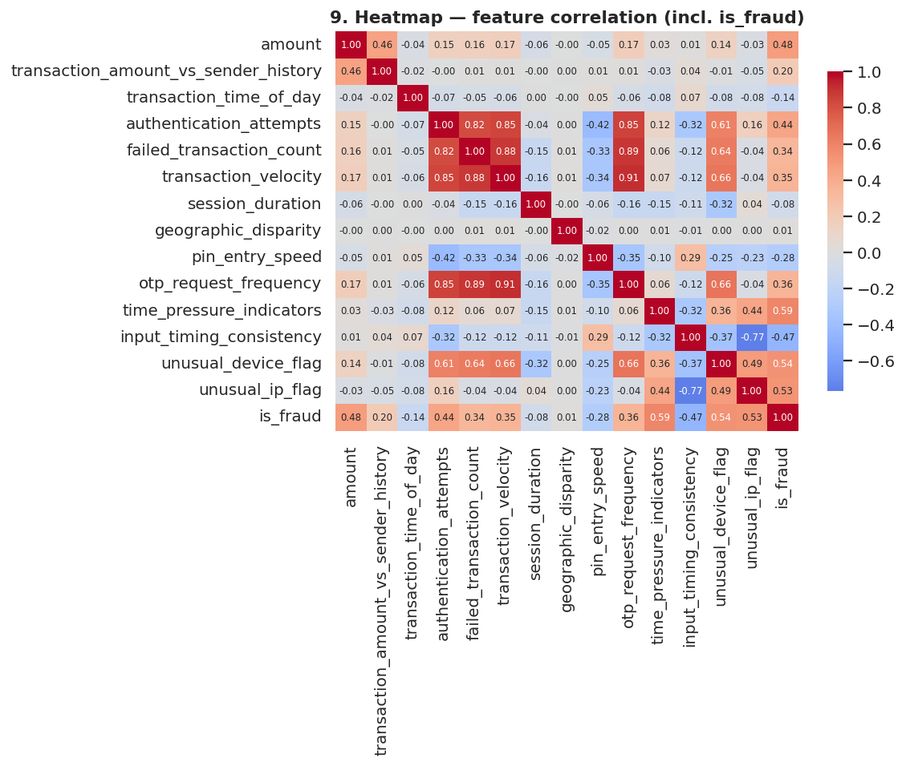
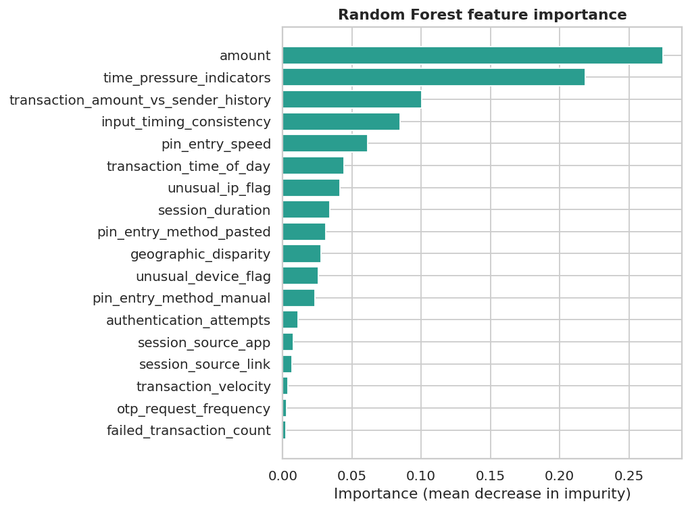

<div align="center">


# 🛡️ PaySafe India — UPI Fraud Detection System

**Real-time AI-powered fraud interception for India's Unified Payments Interface (UPI)**

[](https://www.python.org/)
[](https://jupyter.org/)
[](https://scikit-learn.org/)
[](https://flask.palletsprojects.com/)
[](https://numpy.org/)
[](https://pandas.pydata.org/)
[](https://matplotlib.org/)
[](https://seaborn.pydata.org/)
[](LICENSE)

**Team Void Alchemist** · Major Project · 2026

[📒 Notebook](notebooks/PaySafeIndia.ipynb) · [🌐 Live Demo](http://127.0.0.1:5001) · [📊 Research Charts](images/) · [📄 Viva Guide](PaySafe_Comprehensive_Viva_Guide.pdf)

</div>

---

## 📌 Project Overview

PaySafe India is an end-to-end **ML-powered UPI Fraud Detection & Prevention System** that intercepts high-risk transactions *before* funds are transferred. It combines unsupervised behavioral clustering with supervised ensemble classification, exposed through a production-style Flask API and an interactive mobile-first prototype.

> **Problem Statement:** UPI fraud in India crossed ₹1,750 crore in FY2024. Traditional rule-based systems fail against novel social engineering attacks. PaySafe India uses behavioral telemetry, K-Means clustering, and Random Forest to stop fraud in real-time — within NPCI's 2-second transaction window.

---

## 🏗️ System Architecture

```
┌─────────────────────────────────────────────────────────────────┐
│                     DATA LAYER (3 Datasets)                     │
│  fraud_dataset.csv (26,393)  │  upi_fraud_india (1,000)  │  upi_transactions_2024 (2,50,000)  │
└──────────────────────────────┬──────────────────────────────────┘
                               │
              ┌────────────────▼─────────────────┐
              │     PREPROCESSING (Module 6)      │
              │  LabelEncoder → StandardScaler    │
              │  80/20 Stratified Split           │
              └────────────────┬─────────────────┘
                               │
         ┌─────────────────────▼──────────────────────┐
         │      UNSUPERVISED LAYER (Module 10)         │
         │   K-Means Clustering (K=4, Silhouette 0.28) │
         │   → Cluster ID appended as engineered feature│
         └─────────────────────┬──────────────────────┘
                               │
         ┌─────────────────────▼──────────────────────┐
         │      SUPERVISED LAYER (Modules 7, 8, 9)     │
         │   Random Forest ← WINNER (F1: 92.65%)       │
         │   Decision Tree  │  Logistic Reg │  SVM     │
         └─────────────────────┬──────────────────────┘
                               │
         ┌─────────────────────▼──────────────────────┐
         │   FLASK REST API  (/api/predict)            │
         │   joblib.load → predict_proba → risk %      │
         └─────────────────────┬──────────────────────┘
                               │
         ┌─────────────────────▼──────────────────────┐
         │   MOBILE-FIRST PROTOTYPE (app/templates)    │
         │   Swipe-to-Pay → Live Risk Score → Block    │
         └────────────────────────────────────────────┘
```

---

## 📊 Model Performance Summary

| Model | Accuracy | Precision | Recall | F1-Score | ROC-AUC |
|---|---|---|---|---|---|
| **🏆 Random Forest** | **97.65%** | **98.28%** | **87.90%** | **92.65%** | **0.969** |
| Logistic Regression | 97.10% | 96.80% | 88.00% | 92.20% | — |
| Decision Tree | 96.80% | 95.40% | 86.10% | 90.50% | — |
| SVM (RBF Kernel) | 84.20% | 68.10% | 48.70% | 56.83% | — |

> **K-Means Clustering** — Silhouette Score: **0.2761** (K=4 chosen via Elbow Method)
> **Dataset Split** — Train: 21,114 · Test: 5,279 · Fraud Ratio: 17.22%

---

## 🔑 Top 5 Feature Importances (Random Forest)

```
amount                              ████████████████████████████  27.4%
time_pressure_indicators            ██████████████████████████    24.1%
transaction_amount_vs_sender_history ███████████                  11.0%
input_timing_consistency            █████████                     9.2%
cluster (K-Means)                   █████                         4.9%
```

---

## 📂 Repository Structure

```
upi_fraud_project/
│
├── 📒 notebooks/
│   ├── PaySafeIndia.ipynb          ← Main project notebook (21 cells, 10 modules)
│   ├── main_analysis.ipynb         ← Extended analysis notebook
│   └── README.md                   ← Notebook guide & cell-by-cell map
│
├── 🖼️ images/
│   ├── eda_correlation_heatmap.png ← Seaborn heatmap (Cell 12)
│   ├── kmeans_elbow_plot.png       ← Elbow + Silhouette (Cell 17)
│   ├── kmeans_clusters_pca.png     ← PCA cluster projection (Cell 17)
│   ├── rf_feature_importance.png   ← RF importances (Cell 19)
│   ├── confusion_matrices.png      ← All 4 models (Cell 19)
│   ├── roc_curves.png              ← ROC curves (Cell 20)
│   ├── india_rupee_bg.jpg          ← UI background asset
│   └── README.md                   ← Image index
│
├── 📊 outputs/charts/              ← Full chart library (13 plots)
│
├── 🗄️ data/
│   ├── fraud_dataset.csv           ← Primary dataset (26,393 rows, 18 features)
│   ├── upi_fraud_india_dataset.csv ← UPI behavioral dataset (1,000 rows)
│   └── upi_transactions_2024.csv   ← Synthetic transaction log (2,50,000 rows)
│
├── 🤖 models/
│   ├── fraud_model.joblib          ← Trained Random Forest (joblib serialized)
│   └── model_meta.json             ← Feature schema + evaluation metrics
│
├── 🌐 app/
│   ├── app.py                      ← Flask server + /api/predict endpoint
│   └── templates/index.html        ← Mobile-first UPI prototype UI
│
├── 📄 docs/
│   ├── PRESENTATION_SCRIPT.md      ← Full presentation narration
│   └── VIVA_CrossQuestions.md      ← Viva Q&A preparation guide
│
├── PaySafe_Comprehensive_Viva_Guide.pdf  ← 34-question viva defense PDF
├── PaySafe_Builder_Journey.pdf           ← Project journey documentation
├── requirements.txt                       ← Python dependencies
└── README.md                             ← This file
```

---

## 🚀 Quick Start

### 1. Clone the Repository
```bash
git clone https://github.com/Avijit010325/UPI_Fraud-detection_web.git
cd UPI_Fraud-detection_web
```

### 2. Install Dependencies
```bash
pip install -r requirements.txt
```

### 3. Run the Jupyter Notebook
```bash
jupyter notebook notebooks/PaySafeIndia.ipynb
```

### 4. Launch the Live Demo
```bash
python app/app.py
# Open: http://127.0.0.1:5001
```

---

## 🧪 Test the Live Fraud Detection API

```bash
# Safe transaction (₹40 chai payment)
curl -X POST http://127.0.0.1:5001/api/predict \
  -H "Content-Type: application/json" \
  -d '{"amount": 40, "transaction_time_of_day": 10, "transaction_amount_vs_sender_history": 0.8, "authentication_attempts": 1, "failed_transaction_count": 0, "unusual_device_flag": 0, "unusual_ip_flag": 0, "session_source": "app", "pin_entry_method": "manual", "time_pressure_indicators": 0, "input_timing_consistency": 0.9, "pin_entry_speed": 1.2, "transaction_velocity": 0, "otp_request_frequency": 0, "session_duration": 165, "geographic_disparity": 9964}'

# Fraud transaction (Fake KYC scam — ₹95,000)
curl -X POST http://127.0.0.1:5001/api/predict \
  -H "Content-Type: application/json" \
  -d '{"amount": 95000, "transaction_time_of_day": 2, "transaction_amount_vs_sender_history": 8.5, "authentication_attempts": 4, "failed_transaction_count": 2, "unusual_device_flag": 1, "unusual_ip_flag": 1, "session_source": "link", "pin_entry_method": "pasted", "time_pressure_indicators": 3, "transaction_velocity": 4, "otp_request_frequency": 2, "input_timing_consistency": 0.3, "pin_entry_speed": 0.1, "session_duration": 45, "geographic_disparity": 18000}'
```

**Expected responses:**
```json
// Safe: {"percent": 0.5, "is_fraud": false, "cluster_id": 0, "band": "low"}
// Fraud: {"percent": 97.1, "is_fraud": true, "cluster_id": 3, "band": "high"}
```

---

## 🔬 Research Visualizations

<div align="center">

| Correlation Heatmap | K-Means Elbow Plot | Feature Importances |
|---|---|---|
|  |  |  |

| Confusion Matrices | ROC Curves | PCA Cluster View |
|---|---|---|
|  |  |  |

</div>

---

## 📦 Requirements

```
numpy>=1.24.0
pandas>=2.0.0
matplotlib>=3.7.0
seaborn>=0.12.0
scikit-learn>=1.3.0
flask>=3.0.0
joblib>=1.3.0
jupyter>=1.0.0
```

---

## 🛡️ Fraud Detection Signals

The model evaluates **18 behavioral signals** per transaction:

| Category | Features |
|---|---|
| **Transaction** | `amount`, `transaction_amount_vs_sender_history`, `transaction_time_of_day`, `transaction_velocity`, `failed_transaction_count` |
| **Authentication** | `authentication_attempts`, `otp_request_frequency`, `pin_entry_method`, `session_source` |
| **Device & Location** | `unusual_device_flag`, `unusual_ip_flag`, `geographic_disparity` |
| **Behavioral Biometrics** | `time_pressure_indicators`, `input_timing_consistency`, `pin_entry_speed`, `session_duration` |

---

## 👥 Team Void Alchemist

| Member | Role |
|---|---|
| **Avijit Aditya** | ML Pipeline · Flask API · Frontend Prototype |
| **Vinit Chaurasua** | Data Engineering · K-Means Clustering |
| **Vishal Thakur** | Model Evaluation · Visualization |
| **Priyanshu Chakraborty** | Feature Engineering · Documentation |

---

## 📄 License

This project is licensed under the **MIT License** — see [LICENSE](LICENSE) for details.

---

<div align="center">

Made with ❤️ for India's Digital Payment Security · 2026

**PaySafe India** · UPI Fraud Detection · Team Void Alchemist

</div>
